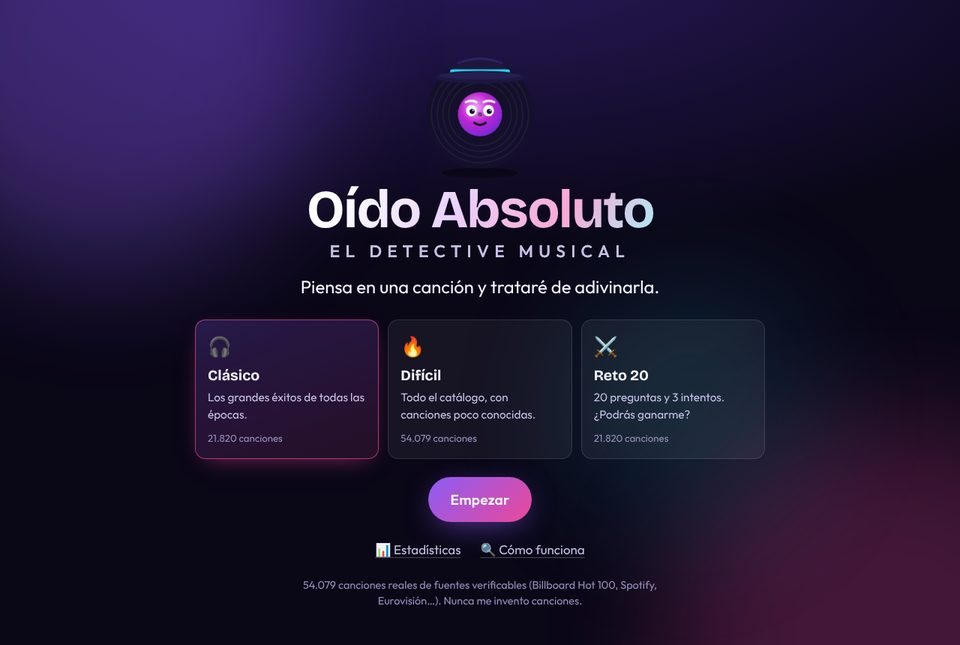
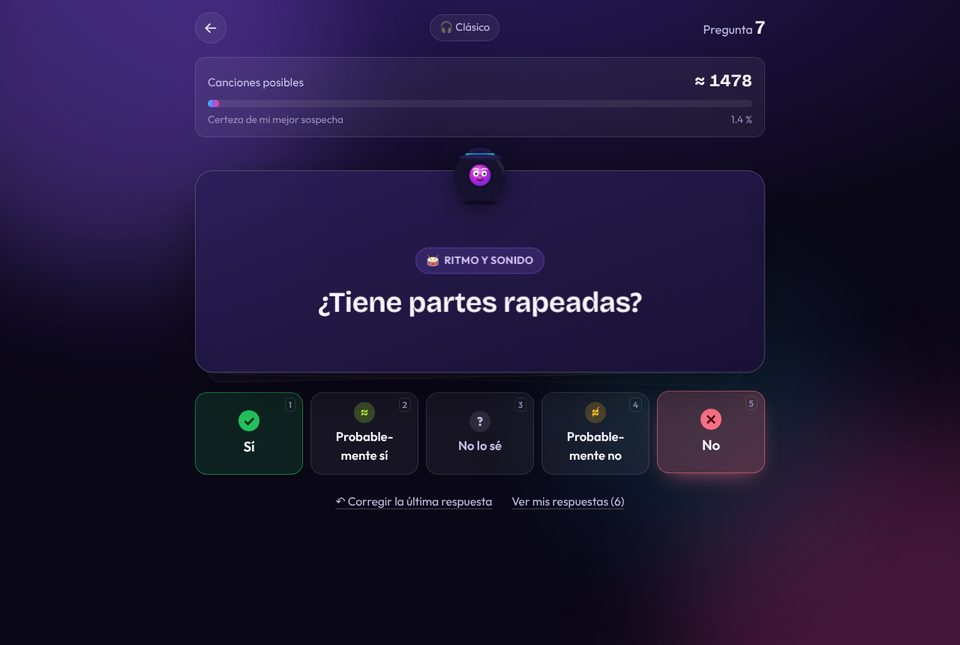
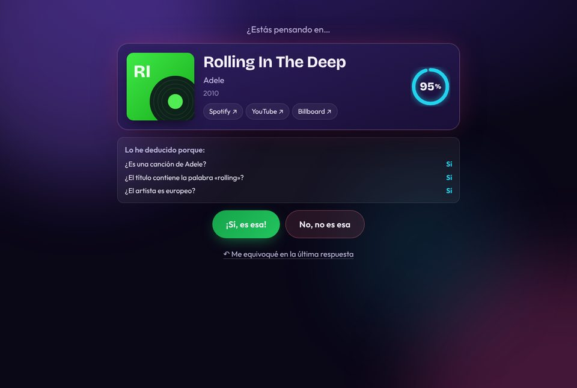
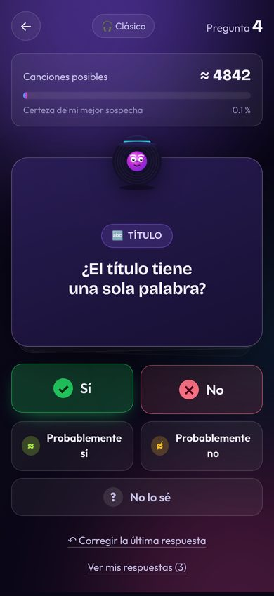
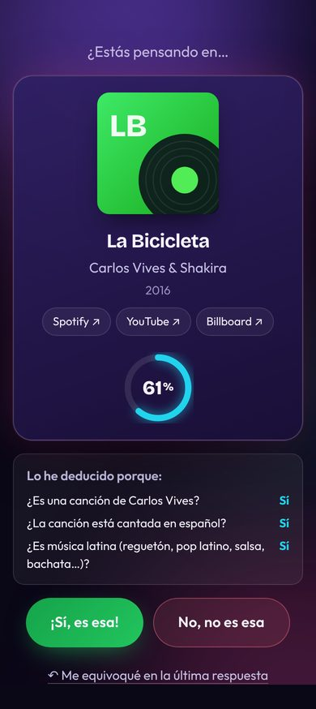

# Oído Absoluto · el detective musical

> **«Piensa en una canción y trataré de adivinarla.»**

Aplicación web inspirada en Akinator y especializada en canciones. Funciona como un detective musical: calcula la
probabilidad de cada canción del catálogo, elige en cada turno la pregunta que más posibilidades descarta y propone
una canción cuando tiene suficiente confianza. **No usa un cuestionario fijo, no pregunta al azar y no se inventa
canciones**: solo propone canciones de un catálogo construido con fuentes verificables.

| Inicio | Pregunta | Intento |
|---|---|---|
|  |  |  |

<p align="center">
  
  
</p>

> «Akinator» es una marca registrada de Elokence, así que la interfaz usa un nombre propio. Se cambia en
> `apps/web/src/config.ts`.

## Qué incluye

- **Motor bayesiano con ganancia de información**: posterior sobre ~54.000 canciones, cinco respuestas posibles
  (sí, probablemente sí, no lo sé, probablemente no, no) con un modelo probabilístico. Ninguna respuesta elimina una
  canción de golpe, así que el juego se recupera de los errores del jugador.
- **Preguntas que se adaptan a la partida**: más de 130 fijas (época, idioma, voz, origen, género, ritmo, letra, cine
  y series, éxito, título, curiosidades) y otras dinámicas («¿Es una canción de X?», «¿El título contiene la palabra
  Y?») que aparecen cuando son útiles.
- **Sin preguntas repetitivas ni inútiles**:
  - Nunca repite una pregunta.
  - Cierra grupos exclusivos y aplica la lógica de intervalos de años.
  - Descarta preguntas cuya respuesta ya es casi segura.
  - Penaliza encadenar preguntas de la misma familia.
  - Si contestas «No lo sé», evita esa familia de preguntas.
- **Intentos con su porcentaje de confianza** y la explicación de la deducción («lo he deducido porque…»). El
  porcentaje está calibrado: lo que se anuncia al 80 % acierta de verdad unas 8 de cada 10 veces en el benchmark.
  Tras un fallo descarta la canción y sigue investigando. Tras dos fallos pasa a un modelo más tolerante con los
  errores.
- **Aprendizaje**:
  - Cada partida confirmada suma sus respuestas a la canción (modelo Beta-Bernoulli).
  - La tasa de «no lo sé» de cada pregunta se ajusta sola.
  - Al final pregunta sobre los datos que faltan (viral en TikTok, videojuego, voz…).
- **Modos**:
  - **Clásico**: unos 22.000 éxitos.
  - **Difícil**: el catálogo completo, con canciones poco conocidas.
  - **Reto 20**: competitivo, con 20 preguntas y 3 intentos. La IA arriesga antes y hay marcador Tú contra IA con
    puntos.
- **Estadísticas**: personales (en el navegador) y globales (servidor). Incluyen el histograma de preguntas
  necesarias, el récord, el marcador del reto y las canciones más pensadas.
- **Interfaz**: tarjetas animadas, mascota original, redoble y revelación con anillo de confianza, confeti y atajos
  de teclado (`1`–`5` para responder, retroceso para corregir, `S`/`N` en los intentos). Está adaptada a móvil y
  respeta `prefers-reduced-motion`.

## Puesta en marcha

Requisitos: **Node.js ≥ 22.12**. SQLite viene integrado en Node (`node:sqlite`), así que no hay dependencias
nativas.

```bash
npm install
```

```bash
npm run build
```

```bash
npm start
```

Abre <http://localhost:3001>. El servidor carga el catálogo incluido en el repositorio y sirve la interfaz.

Desarrollo con recarga en caliente (API en el puerto 3001, Vite en <http://localhost:5173>):

```bash
npm run dev
```

Otras órdenes:

| Orden | Qué hace |
|---|---|
| `npm test` | Tests del motor, del pipeline, del conector de Wikidata y de la API (Vitest) |
| `npm run typecheck` | Comprobación de tipos de los cuatro paquetes |
| `npm run bench` | Benchmark con jugadores simulados → [`docs/BENCHMARK.md`](docs/BENCHMARK.md) |
| `npm run e2e` | Partidas reales en Chromium (escritorio, móvil y Reto 20) con el servidor en marcha. Requiere Playwright: `npm i -D playwright && npx playwright install chromium` |
| `npm run data:build` | Descarga las fuentes abiertas y regenera `data/catalog/catalog.json.gz` |
| `npm run data:wikidata` | Descarga canciones e intérpretes de Wikidata (requiere acceso a `query.wikidata.org`) |

Variables de entorno del servidor: `PORT` (3001), `HOST` (0.0.0.0), `DB_PATH` (`data/state/akinator.sqlite`),
`CATALOG_PATH`, `STATIC_DIR` y `TRUST_PROXY=1`. Esta última hace falta detrás de un proxy inverso, para que el
limitador de escrituras vea la IP real.

## Arquitectura

```
packages/engine    Motor puro en TypeScript: preguntas, modelo de respuesta, inferencia, elección de preguntas,
                   aprendizaje y simulador (sin dependencias)
packages/pipeline  Descarga → normalización → fusión de fuentes → hechos probabilísticos con procedencia → catálogo
apps/server        Fastify sin estado de partida + SQLite (aprendizaje y estadísticas) + SPA compilada
apps/web           React 19 + Vite + Motion
data/catalog       Catálogo construido (versionado) e informe de cobertura
docs               Análisis y arquitectura, benchmark y capturas
```

El análisis completo que se pidió antes de programar está en
[`docs/ARQUITECTURA.md`](docs/ARQUITECTURA.md): arquitectura, investigación de APIs y sus límites, motor de preguntas,
anti-repetición y escalabilidad.

### API

| Método | Ruta | Uso |
|---|---|---|
| `POST` | `/api/game/step` | `{mode, answers, guesses, seed}` → siguiente pregunta, intento o rendición. El servidor no guarda la partida: el cliente envía su historial (deshacer sale gratis y escala horizontalmente) |
| `POST` | `/api/game/finish` | Registra la partida, aprende de las respuestas si se conoce la canción y devuelve discrepancias y preguntas de aprendizaje |
| `POST` | `/api/game/learn` | Respuestas extra sobre la canción confirmada (una vez por partida) |
| `GET` | `/api/search?q=` | Búsqueda en el catálogo (para «¿en qué canción pensabas?») |
| `GET` | `/api/stats` · `/api/meta` · `/api/song/:id` | Estadísticas globales, metadatos y procedencia |
| `POST` | `/api/missing` | Sugerencia de canción que no está en el catálogo. Se guarda sin verificar y **no** entra en el juego |

## Datos

El catálogo incluido (`data/catalog/catalog.json.gz`, 54.079 canciones y 18.207 artistas) procede de datasets
abiertos:

- Billboard Hot 100 completo (1958 → 2026), archivado por
  [mhollingshead/billboard-hot-100](https://github.com/mhollingshead/billboard-hot-100).
- Rasgos de audio y géneros de Spotify, de [TidyTuesday](https://github.com/rfordatascience/tidytuesday) 2021 y 2020
  (CC0).
- Los 1.177 números 1 anotados a mano en *Uncharted Territory* (TidyTuesday 2025, CC0). Las letras no se guardan.
- Eurovisión 1956-2022, Rolling Stone 500 y la encuesta de hip hop de la BBC (TidyTuesday, CC0).

Cada canción conserva su procedencia (semanas en el Billboard, ID de Spotify, edición de Eurovisión…), que se
muestra en la app con enlaces. Los atributos derivados (idioma, país, género…) se guardan como **probabilidades**,
no como hechos. Cuando falta un dato, el motor usa la tasa de canciones parecidas (mismo género y década) y nunca la
presenta como un hecho. La cobertura por atributo está en [`data/catalog/coverage.json`](data/catalog/coverage.json).

### Ampliar el catálogo con Wikidata

El entorno donde se desarrolló bloqueaba Wikidata, Wikipedia, Deezer y MusicBrainz por política de red. Por eso el
catálogo semilla está sesgado hacia las listas de EE. UU. y la música latina de Spotify, y tiene huecos en la música
española clásica y en el género de la voz. El conector de Wikidata ya está implementado y probado con respuestas de
ejemplo, pero **no se ha ejecutado contra el servicio real**. En una máquina con acceso a Internet:

```bash
npm run data:wikidata
```

```bash
npm run data:build -- --offline
```

Añade canciones con artículo en la Wikipedia en español o en al menos tres Wikipedias. Con ellas llegan el idioma
de la obra, el tipo, el género y la nacionalidad de los intérpretes, y los temas de películas, series y videojuegos.

## Resultados

El benchmark (`npm run bench`) enfrenta el motor a jugadores simulados que dudan y se equivocan, y lo compara con la
misma inferencia usando preguntas al azar y un cuestionario fijo. Resultados completos y calibración de la confianza
en [`docs/BENCHMARK.md`](docs/BENCHMARK.md).

<!-- RESULTADOS -->

## Limitaciones conocidas

- **Datos**: la limitación principal hoy es el catálogo, no el motor. Lo que más ayudará es ejecutar el conector
  de Wikidata y añadir Deezer o iTunes para carátulas y previews.
- **TikTok**: no existe ninguna fuente pública y fiable de canciones virales. La pregunta se aprende de los
  jugadores y existe una señal débil (artistas con etiqueta *viral pop* de Spotify).
- **Letras**: tienen derechos de autor. Se usan temáticas anotadas, la etiqueta de contenido explícito y el título.
- **Benchmark**: el jugador simulado responde según los mismos datos que usa el motor, así que mide la estrategia, no
  la precisión de los datos frente a personas reales.
