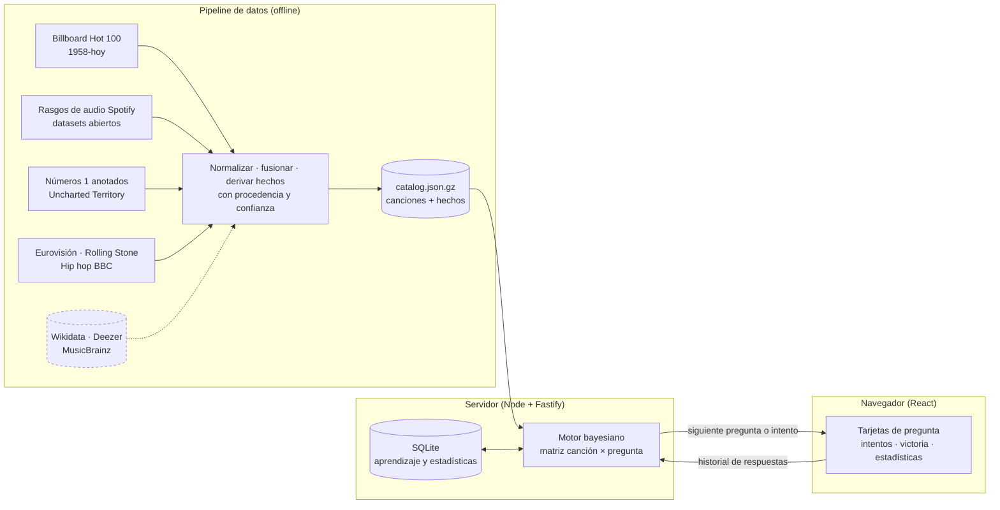

# Akinator Musical: análisis previo y arquitectura

Este documento recoge el análisis que pediste **antes de programar**:

1. La mejor arquitectura para el proyecto.
2. Las APIs y fuentes musicales disponibles, con sus limitaciones.
3. Cómo funciona el motor de preguntas y de descarte de canciones.
4. Cómo se evitan las preguntas repetitivas o poco útiles.
5. Una arquitectura escalable y eficiente.

Al final están las fases de desarrollo y el estado real de cada una. Los resultados medidos (cobertura de
datos y benchmark del motor) están en [`BENCHMARK.md`](BENCHMARK.md) y en
[`data/catalog/coverage.json`](../data/catalog/coverage.json).

> **Nombre de la app.** El repositorio se llama *akinatormusical*, pero «Akinator» es una marca registrada
> (Elokence). La interfaz usa un nombre propio, **Oído Absoluto · el detective musical**, configurable en una
> sola constante (`apps/web/src/config.ts`).

---

## 0. Resumen de decisiones

| Decisión | Elección | Motivo |
|---|---|---|
| Motor de IA | **Inferencia bayesiana + máxima ganancia de información esperada** | Es lo que hace que cada pregunta sea la que más canciones descarta. Es matemáticamente óptimo a un paso, explicable y funciona sin GPU ni APIs de pago |
| Respuestas difusas | Modelo de respuesta probabilístico con 5 respuestas | «Probablemente sí» o «No lo sé» ajustan las probabilidades sin eliminar canciones de golpe, así que una respuesta equivocada no arruina la partida |
| Datos | Catálogo propio construido offline desde fuentes verificables, con procedencia por canción | La IA **nunca genera** canciones: solo elige entre registros que proceden de una fuente citada |
| Aprendizaje | Conteos Beta-Bernoulli por (canción, pregunta) + tasa de «no lo sé» por pregunta | Es la forma clásica de que el sistema aprenda de las partidas jugadas, y es robusta frente al ruido |
| Lenguaje | TypeScript en todo el monorepo (motor, pipeline, servidor y web) | Un único conjunto de tipos compartido entre motor, API e interfaz |
| Servidor | Node.js + Fastify, **sin estado de partida** | El cliente envía su historial de respuestas y el servidor recalcula. Escala horizontalmente sin sesiones pegajosas y sobrevive a reinicios |
| Persistencia | SQLite (`node:sqlite`, integrado en Node 22) | Cero dependencias nativas. Suficiente para miles de partidas al día y fácil de migrar a PostgreSQL |
| Interfaz | React 19 + Vite + Motion (animaciones) | SPA rápida, transiciones fluidas entre tarjetas y buen soporte móvil |



---

## 1. Investigación de fuentes musicales

### 1.1 APIs y servicios

| Fuente | Qué aporta | Coste y límites | Licencia y condiciones | Uso en el proyecto |
|---|---|---|---|---|
| **Wikidata** (SPARQL + `wbgetentities`) | Canciones con intérprete, fecha, género, idioma, país, premios, bandas sonoras (`P942`), IDs de Spotify, MusicBrainz, YouTube y Genius. Artistas con género, nacionalidad, tipo (grupo o solista) y fechas | Gratis y sin clave. Consultas SPARQL con un máximo de 60 s, cupo de CPU por IP y obligación de enviar un User-Agent descriptivo | **CC0** (dominio público) | **Fuente canónica recomendada** para enriquecer el catálogo (idioma, país y género del artista, cine y series). Conector preparado en `packages/pipeline/src/sources/wikidata.ts` |
| **MusicBrainz** | Decenas de millones de grabaciones y millones de artistas. Fechas, duración, ISRC, área y género del artista, etiquetas y géneros comunitarios | Gratis. **1 petición/s** por IP. Volcados completos de PostgreSQL dos veces por semana | Núcleo **CC0**. Parte de los datos complementarios con CC BY-NC-SA | Escalar a millones de grabaciones mediante los volcados (sin pasar por la API) |
| **ListenBrainz** | Popularidad real (escuchas y oyentes) por grabación de MusicBrainz | Gratis, con API y volcados | Datos abiertos | Popularidad para el *long tail* a gran escala |
| **Deezer API** | `rank` (popularidad), `bpm`, `explicit_lyrics`, duración, fecha, **preview MP3 de 30 s** y carátulas. Búsqueda de catálogo | Gratis y **sin clave** para lectura. Unas 50 peticiones cada 5 s. Admite JSONP para usarla desde el navegador | Condiciones de Deezer, con atribución obligatoria | Enriquecimiento (BPM, explícito, popularidad) y carátulas y previews en la pantalla de victoria |
| **iTunes Search API** | Género principal, fecha, carátula y preview de 30 s | Gratis, sin clave. Unas 20 peticiones por minuto | Hay que enlazar a Apple. Uso promocional | Alternativa a Deezer para carátulas y previews |
| **Spotify Web API** | Popularidad 0-100 y géneros de artista | Requiere registrar una app. **Desde el 27/11/2024 las apps nuevas no tienen acceso** a *audio features*, *audio analysis*, recomendaciones, artistas relacionados ni playlists editoriales | Los términos **prohíben usar contenido de Spotify para entrenar o alimentar modelos de IA** y limitan el almacenamiento | **No sirve como base de datos.** Solo se usan enlaces profundos (`open.spotify.com/track/…`) a partir de IDs ya presentes en datasets abiertos |
| **Last.fm API** | Etiquetas comunitarias (`female vocalists`, `sad`, `80s`, `soundtrack`…), oyentes y reproducciones | Clave gratuita. Uso no comercial | Atribución obligatoria. Comercial solo con acuerdo | Opcional: rasgos subjetivos (estado de ánimo, voz). Mejora prevista si se aporta clave |
| **Discogs** | Géneros y estilos muy finos por lanzamiento | 60 peticiones/min con token. Volcados mensuales | Volcados **CC0** | Opcional: estilos y subgéneros |
| **Genius API** | Metadatos de la canción y artistas invitados | Token gratuito. **La API no devuelve letras**, y extraerlas de la web viola sus condiciones | Condiciones de Genius | No se usa para letras |
| **Musixmatch** | Letras | Plan gratuito limitado (solo un 30 % de cada letra, uso no comercial) | Las letras tienen copyright | **No viable** para analizar letras completas |
| **AcousticBrainz** | BPM, tonalidad, bailabilidad, voz e instrumental, clasificadores de género y estado de ánimo | **Cerrado en 2022**. Solo quedan volcados históricos de varias decenas de GB | CC0 | Posible enriquecimiento masivo offline, con clasificadores ruidosos |
| **Wikipedia / Wikimedia** | Páginas vistas (popularidad actual), categorías («Canciones de películas», «Números 1 en España»…) y menciones textuales (p. ej. «TikTok») | Gratis | Metadatos libres. Texto CC BY-SA | Popularidad actual y señal **verificable** de viralidad: el artículo menciona TikTok |
| **TikTok** | Sonidos virales | **Sin API pública** de tendencias. La Research API solo se concede a investigadores aprobados. Creative Center no es una API y el scraping viola sus términos | — | **No viable directamente.** Ver la alternativa en §1.4 |
| **Billboard** | Listas semanales del Hot 100 desde 1958 | Sin API oficial. Hay proyectos abiertos que archivan las listas | Los datos de las listas son hechos. Hay que atribuir | Popularidad histórica, año de lanzamiento aproximado, picos y números 1 |

### 1.2 Datasets abiertos utilizados en el catálogo semilla

| Dataset | Contenido | Licencia |
|---|---|---|
| [`mhollingshead/billboard-hot-100`](https://github.com/mhollingshead/billboard-hot-100) | Todas las listas del Billboard Hot 100 (1958 → actualizadas a diario) | Hechos de listas, con atribución a Billboard |
| [TidyTuesday 2021-09-14](https://github.com/rfordatascience/tidytuesday/tree/main/data/2021/2021-09-14) | Hot 100 1958-2021 + rasgos de audio de Spotify (tempo, energía, valencia…) y géneros de artista | CC0 (repositorio TidyTuesday) |
| [TidyTuesday 2020-01-21](https://github.com/rfordatascience/tidytuesday/tree/main/data/2020/2020-01-21) | ~28.000 canciones de playlists de Spotify (pop, rock, rap, R&B, **latina**, EDM) con subgénero y rasgos de audio | CC0 |
| [TidyTuesday 2025-08-26](https://github.com/rfordatascience/tidytuesday/tree/main/data/2025/2025-08-26) | Los 1.177 números 1 del Hot 100 anotados a mano por Chris Dalla Riva (*Uncharted Territory*): voz, origen, temática de la letra, instrumentos, cine y series… | CC0. **No se guardan las letras**, solo las anotaciones |
| [TidyTuesday 2022-05-17](https://github.com/rfordatascience/tidytuesday/tree/main/data/2022/2022-05-17) | Participantes de Eurovisión 1956-2022 | CC0 |
| [TidyTuesday 2024-05-07](https://github.com/rfordatascience/tidytuesday/tree/main/data/2024/2024-05-07) | Rolling Stone 500 álbumes: género del artista y número de miembros | CC0 |
| [TidyTuesday 2020-04-14](https://github.com/rfordatascience/tidytuesday/tree/main/data/2020/2020-04-14) | Encuesta de la BBC de mejores canciones de hip hop, con género del artista | CC0 |

### 1.3 Restricción del entorno actual (importante)

El entorno donde se ha desarrollado esta primera versión **bloquea por política de red** `wikidata.org`,
`wikipedia.org`, `deezer.com`, `musicbrainz.org`, `last.fm`, `discogs.com` y `spotify.com`. Solo permite
`raw.githubusercontent.com` y los registros de paquetes. Por eso:

- El **catálogo semilla** se ha construido solo con los datasets abiertos de §1.2. Son datos reales y
  verificables: cada canción enlaza a su lista de Billboard, a su pista de Spotify o a su página de Eurovisión.
- Ese catálogo está **sesgado hacia las listas de EE. UU.** y su bloque de música en español procede sobre todo
  de las playlists latinas de Spotify (reguetón, pop latino, tropical). Faltan clásicos de España (Mecano,
  Héroes del Silencio, Sabina…), que llegarán con el conector de Wikidata.
- El conector de Wikidata está implementado, pero **no se ha podido ejecutar contra la API real** desde aquí.
  Se ejecuta con `npm run data:wikidata` en cualquier máquina con acceso a Internet. En la configuración del
  entorno cloud se pueden permitir esos dominios (*Network access*).

### 1.4 Atributos pedidos: de dónde sale cada uno

| Atributo | Fuente en el catálogo semilla | Con Wikidata/Deezer | Notas |
|---|---|---|---|
| Género musical y estilo | Géneros de artista de Spotify (1.145 etiquetas → taxonomía propia de ~40 géneros), playlists, anotaciones de números 1 | `P136` + jerarquía `P279` | Taxonomía jerárquica: «¿Es rock?» → «¿Es hard rock?» |
| Idioma | Derivado con reglas explícitas: anotación de los números 1, idioma del título, géneros latinos o K-pop, regla histórica de Eurovisión | `P407` | Se guarda como **probabilidad**, nunca como hecho inventado |
| Década o año | Primera semana en el Billboard (fiable) o fecha del álbum (menos fiable, umbral más blando) | `P577` | — |
| Artista o grupo | Créditos del Billboard divididos con un heurístico basado en los propios datos | `P175` | Preguntas dinámicas «¿La canta X?» |
| Voz masculina, femenina o instrumental | Números 1, Rolling Stone y BBC propagados por artista, géneros «girl group» o «boy band», instrumentalidad de Spotify | `P21` del artista | Es el hueco de cobertura más importante del catálogo semilla |
| Popularidad | Pico y semanas en el Billboard, popularidad de Spotify, puesto en Eurovisión | Deezer `rank`, páginas vistas | Define el prior y los modos de juego |
| Ritmo y velocidad | Tempo, energía y bailabilidad de Spotify (datasets abiertos) | Deezer `bpm` | Umbrales suaves |
| Película, videojuego o serie | Anotaciones de los números 1, nombres de álbum («Motion Picture Soundtrack»), títulos «(From …)» | `P942`, `P1441` | **Videojuegos: sin fuente en el catálogo semilla.** Se aprende de los jugadores |
| Viral en TikTok o redes | **Sin fuente directa** (ver abajo) | Menciones en Wikipedia | Pregunta de aprendizaje |
| Antigua o reciente | Año | Año | — |
| Letra | Temática anotada de los números 1, etiqueta *explicit* de Spotify, palabras del título | `P921` (tema) | Las letras completas tienen copyright y no se usan |
| País del artista | Origen anotado de los números 1, tokens de nacionalidad en géneros de Spotify («canadian pop», «puerto rican pop»…), país en Eurovisión | `P27`, `P495`, `P740` | — |

**Alternativa realista para «viral en TikTok» y «videojuego».** No existe ninguna fuente gratuita y verificable de
viralidad en TikTok. En lugar de simularla, el sistema la **aprende**:

1. Al terminar una partida, ya con la canción confirmada, la app hace 2 o 3 preguntas de aprendizaje sobre los
   atributos que faltan («¿Esta canción se hizo viral en TikTok?»).
2. Esas respuestas, dadas por quien conoce la canción, se guardan como evidencia Beta-Bernoulli y empiezan a
   usarse en las partidas siguientes.
3. Con acceso a Wikipedia, el pipeline puede añadir la señal «el artículo de la canción menciona TikTok».

Mientras una canción no tenga evidencia, la pregunta tiene ganancia de información casi nula y el motor no la
hace durante la partida, así que nunca se finge un conocimiento que no se tiene.

---

## 2. Arquitectura del sistema

```
akinatormusical/
├── packages/
│   ├── engine/      # Motor puro en TypeScript, sin dependencias: preguntas, modelo, inferencia, simulador
│   └── pipeline/    # Descarga → normalización → fusión → derivación de hechos → catálogo
├── apps/
│   ├── server/      # API Fastify sin estado + SQLite (aprendizaje y estadísticas) + sirve la SPA
│   └── web/         # React + Vite + Motion
├── data/catalog/    # Catálogo construido (versionado) + informe de cobertura
└── docs/            # Este documento y el benchmark
```

### 2.1 Flujo de una partida

1. El cliente llama a `POST /api/game/step` con `{ mode, answers: [{q, a}], rejected: [songId] }`.
2. El servidor reconstruye el posterior desde cero. Con N = 60.000 canciones y 30 respuestas son unos 1,8 M de
   operaciones, menos de 10 ms.
3. El servidor decide entre **preguntar** (la mejor pregunta según la ganancia de información), **intentar**
   (propone una canción con su % de confianza) o **rendirse**.
4. Al terminar, `POST /api/game/finish` guarda la partida y **aprende**: actualiza los conteos de la canción
   confirmada y la tasa de «no lo sé». Devuelve qué respuestas no cuadraban con los datos.

Que el servidor no guarde la partida en curso no es un atajo: permite **deshacer** respuestas gratis, escalar
con varias réplicas detrás de un balanceador y no perder partidas si el proceso se reinicia.

### 2.2 Modelo de datos

**Canción** (catálogo): `id` estable (hash del título y artista normalizados), título, crédito, artistas,
año (con calidad: lista o álbum), duración, popularidad 0-1, **hechos probabilísticos** y **procedencia**
(lista de Billboard, pista de Spotify, Eurovisión, anotación de números 1).

**Hechos**: pares `clave → probabilidad` (`lang:es → 0.92`, `g:reggaeton → 0.85`, `voice:female → 0.95`…)
agrupados en familias (`lang`, `g`, `ctry`, `reg`, `voice`…). Si una familia es conocida pero falta un valor,
ese valor se trata como improbable. Si la familia entera falta, el dato es **desconocido** y el motor usa la
tasa base, de modo que **la falta de datos no elimina canciones**.

**Pregunta**: id, texto en español, familia (época, idioma, voz, género…), función `hechos → P(sí)`, grupo
exclusivo (p. ej. idiomas) y tasa *a priori* de «no lo sé» (preguntar el país del artista es más difícil de
responder que preguntar el idioma).

---

## 3. Motor de preguntas y descarte

### 3.1 Prior: qué canción es más probable antes de preguntar

`π₀(s) ∝ (popularidad(s) + 0,05)²` en modo normal: la gente piensa más en éxitos. En modo difícil el prior es
casi plano y el catálogo incluye canciones menos conocidas.

### 3.2 Modelo de respuesta (por qué no hay eliminación brusca)

Para cada canción *s* y pregunta *q*, el motor tiene `p = P(un jugador diría «sí» | s)`: alta si los datos dicen
que sí, baja si dicen que no, y la tasa base si se desconoce. La respuesta del jugador sigue una matriz de
confusión:

| Verdad \ respuesta | Sí | Prob. sí | No lo sé | Prob. no | No |
|---|---|---|---|---|---|
| Es «sí» | 0,78 | 0,14 | 0,05 | 0,02 | 0,01 |
| Es «no» | 0,01 | 0,02 | 0,05 | 0,14 | 0,78 |

`P(respuesta | s) = p·fila_sí + (1 − p)·fila_no`. Consecuencias:

- **«No lo sé»** tiene la misma probabilidad en ambas filas, así que no altera el posterior.
- Un **«Sí»** rotundo multiplica por unas 18 las canciones compatibles frente a las incompatibles, pero no las
  pone a cero. Si el jugador se equivoca, la canción correcta se recupera con las respuestas siguientes.
- **«Probablemente sí»** desplaza las probabilidades con menos fuerza (factor de unas 7).

### 3.3 Actualización bayesiana

```
log w(s) = log π₀(s) + Σₜ log P(aₜ | s, qₜ)        (canciones rechazadas → w = 0)
π(s)     = w(s) / Σ w
```

### 3.4 Elección de la pregunta: ganancia de información esperada

Se elige la pregunta que más reduce la incertidumbre (entropía) sobre la canción:

```
IG(q) = H(A_q) − Σₛ π(s) · H(A_q | s)
```

Como `P(a|s)` es lineal en `p`, `H(A_q)` solo depende de `m_q = Σ π(s)·p(s,q)`, y `H(A_q|s)` sale de una tabla
precalculada sobre `p` cuantizado a 256 niveles. Cada pregunta cuesta **una pasada** sobre las canciones
candidatas, con una multiplicación y dos lecturas de tabla. Las propiedades que interesan salen solas:

- **De general a específico**: al principio la masa está repartida y gana «¿Es anterior al 2000?»; al final
  gana «¿La canta Shakira?».
- **Las preguntas inútiles valen 0**: si todas las candidatas responderían lo mismo, `IG = 0`.
- **Datos desconocidos**: una pregunta sin cobertura entre las candidatas apenas aporta y no se hace.

**Preguntas dinámicas.** Además del catálogo fijo (~110 preguntas), el motor genera en cada turno preguntas
«¿La canta {artista}?» para los artistas con más masa de probabilidad, y calcula su ganancia de forma
analítica.

### 3.5 Política de intento

El motor propone una canción cuando se cumple alguna de estas condiciones:

- La confianza (posterior de la mejor canción) es ≥ 85 %.
- La confianza es ≥ 60 % y hay una ventaja de 8× sobre la segunda.
- Ninguna pregunta aporta más de 0,02 bits.
- Se alcanzan los límites de preguntas del modo.

Si falla, esa canción se descarta (`w = 0`) y el juego **sigue preguntando**. La confianza que se muestra es el
posterior real del intento; su calibración se mide en el benchmark.

### 3.6 Aprendizaje

- **Por (canción, pregunta)**: `p' = (k·p_datos + Σ w(a)) / (k + n)`, con `w(sí)=1`, `w(prob. sí)=0,75`,
  `w(prob. no)=0,25` y `w(no)=0`. «No lo sé» no cuenta. `k` es alto donde hay dato de una fuente (cuesta cambiarlo)
  y bajo donde se desconocía (se aprende rápido).
- **Respondibilidad**: la tasa de «no lo sé» de cada pregunta se actualiza y multiplica su puntuación.
- **Preguntas de aprendizaje** tras la partida, sobre los huecos de la canción confirmada.
- **Canciones que el sistema no conoce**: se registran como sugerencias *pendientes*. Nunca se añaden al juego sin
  una fuente verificable, porque la IA no se inventa canciones.

---

## 4. Cómo se evitan las preguntas repetitivas o poco útiles

1. **No se repite una pregunta ya hecha** (por id).
2. **Ganancia de información**: una pregunta cuya respuesta ya está implícita tiene `IG ≈ 0`. Por ejemplo, tras
   «¿Es de los 80?» → «Sí», la pregunta «¿Es anterior a 1990?» deja de interesar.
3. **Implicaciones lógicas explícitas**:
   - En los grupos exclusivos (idioma, voz…), un «Sí» rotundo cierra el grupo.
   - En las preguntas de época se mantiene el intervalo de años factible y se descartan las que ya están
     resueltas.
4. **Respuesta casi segura**: si `P(sí) > 0,985` o `< 0,015` entre las candidatas, la pregunta se descarta.
5. **Variedad**: una pregunta de la misma familia que la anterior se penaliza ×0,8 (×0,6 si son 2 de las 3
   últimas). Así se evita el «interrogatorio de géneros» cuando hay alternativas casi igual de buenas.
6. **Respondibilidad aprendida**: las preguntas que la gente suele contestar con «No lo sé» bajan de prioridad.

---

## 5. Escalabilidad y eficiencia

| Tamaño del catálogo | Memoria de la matriz (uint8) | Coste por turno | Estrategia |
|---|---|---|---|
| 60 k canciones (actual) | ~7 MB | < 15 ms | Matriz densa canción × pregunta |
| 500 k canciones | ~60 MB | ~30-60 ms | Matriz densa + **conjunto activo** (las canciones que suman el 99,9 % de la masa, con un máximo de 30 k) para elegir pregunta |
| Millones | Columnas compactas por atributo (ids de idioma, país y género + bitsets) y `p` calculado al vuelo | ~50-100 ms | Workers, réplicas sin estado y caché de los primeros turnos (el primer turno siempre es igual) |

- La **actualización del posterior** es O(N·T) y se paraleliza o se trocea sin problema.
- La **elección de pregunta** solo recorre el conjunto activo: tras 5 o 6 respuestas, la masa se concentra en
  unos pocos miles de canciones.
- El **primer turno** es idéntico para todas las partidas de un modo y se precalcula al arrancar.
- **Límite real de escala**: los datos, no el cómputo. Con millones de grabaciones (volcados de MusicBrainz +
  popularidad de ListenBrainz), el *long tail* tiene pocos atributos, y el motor no puede distinguir canciones
  sobre las que no sabe nada. Por eso la cifra útil está en **decenas o cientos de miles de canciones
  «pensables»** con buenos datos. El modo difícil abre el catálogo completo.

---

## 6. Viabilidad de las funciones adicionales

| Función | Estado | Detalle |
|---|---|---|
| % de confianza de cada intento | ✅ Viable | Posterior real de la canción propuesta |
| Indicar si se ha acertado | ✅ Viable | Botones de la pantalla de intento |
| Estadísticas de partidas | ✅ Viable | Locales (`localStorage`) y globales (SQLite) |
| Preguntas necesarias para acertar | ✅ Viable | Pantalla de victoria + histograma en estadísticas |
| Modo difícil | ✅ Viable | Catálogo completo con canciones poco conocidas y prior plano |
| Modo competitivo | ✅ Viable | **Reto 20**: la IA tiene 20 preguntas y 3 intentos y arriesga antes. Si falla, ganas tú, pero tienes que identificar la canción en el catálogo para que cuente |
| Viral en TikTok | ⚠️ Sin fuente | Se aprende de los jugadores (§1.4) |
| Análisis de letras | ⚠️ Parcial | Las letras tienen copyright. Se usan temáticas anotadas, la etiqueta *explicit* y el título |
| Previews de audio y carátulas | ⚠️ Requiere red | Deezer o iTunes en producción. En el catálogo semilla: enlaces a Spotify y YouTube |

---

## 7. Fases de desarrollo

| Fase | Contenido |
|---|---|
| 1. Datos | Pipeline reproducible, catálogo semilla verificable e informe de cobertura |
| 2. Motor | Inferencia, ganancia de información, política de intento, anti-repetición, aprendizaje, simulador y tests |
| 3. Servidor | API sin estado, SQLite, búsqueda en catálogo, estadísticas globales y aprendizaje en caliente |
| 4. Interfaz | Tarjetas animadas, botones de respuesta, contador, animación de intento, victoria y derrota con «enséñame», responsive |
| 5. Extras | Modo difícil, modo Reto, estadísticas personales y preguntas de aprendizaje |
| 6. Siguiente | Ejecutar el conector de Wikidata con red, carátulas y previews de Deezer, señal TikTok vía Wikipedia, PostgreSQL si hay mucho tráfico |
